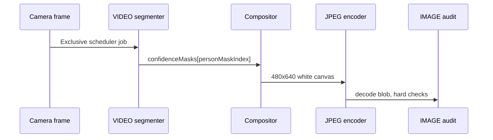

# Background removal

Turn a live camera frame into a **480×640 subject-on-white** JPEG. In this prototype, matting is
**client-owned**: MediaPipe selfie segmentation + `Compositor`. The server does not matte unless
you later replace `compose` or add a server re-matte.

<div class="callout callout-ok">
  <strong>Done when</strong>
  The export JPEG has a white corner (or edge) and the subject is intact — hair/shoulders not
  chewed off, no large background islands left in the crop.
</div>

## What it is

| Step | Result |
| :--- | :--- |
| Unmirrored frame | Capture evidence (never mirrored) |
| MediaPipe VIDEO segmenter | Person **confidence** mask at frame resolution |
| `Compositor` threshold | Soft matte → cutout on `#FFFFFF` |
| JPEG encode | ≤ 30 KB, audited on the decoded output |


## Who owns it

| Layer | Role |
| :--- | :--- |
| **Client** | Segment, crop, composite onto white, encode, hard JPEG audit → ceiling `ClientValidated` |
| **Server / provider** | PAD, frame binding, independent face count, accept/reject → `ProviderAccepted` only when `accepted: true` |

<div class="callout callout-note">
  <strong>Matte is client-owned</strong>
  Production still needs written approval for synthetic background editing — that is a policy /
  acceptance gate, not a “server matte how-to.” See
  <a href="#/guide/server-provider">Server / provider</a> and
  <a href="#/architecture#production-gates">Architecture — production gates</a>.
</div>

## Capture sequence



## Wire `compose` (harness sketch)

From [`web/app.js`](https://github.com/alijamal14/camera/blob/main/web/app.js) and
[`src/browser/compositor.js`](https://github.com/alijamal14/camera/blob/main/src/browser/compositor.js):

- Default `Compositor` **threshold** is `0.5` (confidence below that is background).
- `personMaskIndex` comes from the manifest (`models.selfieSegmenter.personMaskIndex`, usually `0`).
- Use **separate** compositor instances for preview and export so they never share surfaces.

```js
const exportCompositor = new Compositor(); // threshold defaults to 0.5
// personMaskIndex = manifest.models.selfieSegmenter.personMaskIndex ?? 0

compose: async ({ rawFrame, segmentation, crop }) => {
  const canvas = exportCompositor.composite({
    source: rawFrame,
    frameWidth: rawFrame.width,
    frameHeight: rawFrame.height,
    mask: segmentation.confidenceMasks[personMaskIndex],
    crop,
  });
  return encodeJpegUnderCap(canvas);
},
```

Full client wiring: [Client-only](/guide/client-only).

## Preview vs export

| Surface | Mirrored? | Used for |
| :--- | :--- | :--- |
| DOM preview | Yes (display only) | Framing UX |
| `grabFrame` / PAD evidence / export / coordinates | **Never** | Capture truth |

Only the preview paint may mirror. Export, PAD evidence, and geometry stay unmirrored.

## Pitfalls

<div class="callout callout-warn">
  <strong>Common matte failures</strong>
  Hair halos; white clothing merging into the canvas; chair / sofa bleed; background left between
  arm and torso. Review with the
  <a href="#/skills/capture-review">capture-review</a> skill (prefer diagnostic telemetry:
  raw-crop → alpha → composite → output).
</div>

- Do not treat a pretty preview as proof — always inspect the **export** JPEG.
- Do not raise uncalibrated thresholds to HARD without data.
- Do not claim official identity-authority compliance for a client matte.

## Next

1. [How capture works](/guide/how-it-works) — full pipeline  
2. [Client-only](/guide/client-only) — inject `compose`  
3. [Choose path](/guide/choose-path) — when you also need a real provider  
4. [Capture review](/skills/capture-review) — judge real JPEGs  
